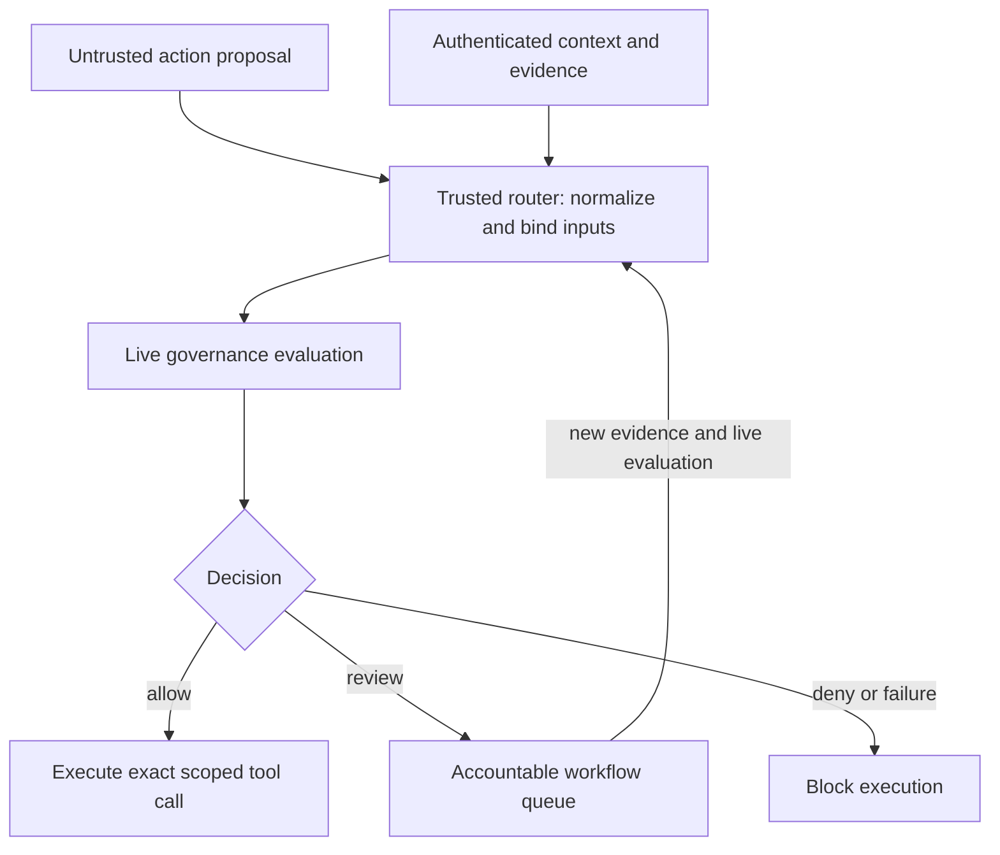

# Tool-router integration

A trusted tool router constructs identity and context from authenticated workload
claims and authoritative systems. Planner-provided role, tenant, impact and data
classification are proposals, not authority. Normalize the exact operation,
resource and arguments before collecting scoped evidence and submitting
`POST /v1/evaluate`.

The router executes a protected tool only for an explicit allow response to
that request. On deny, it blocks execution. On review, it creates an external
workflow task containing the request, audit record ID, policy hash, missing
evidence and returned queue. The reference service returns queue identifiers;
it does not implement a ticketing connector or a human-approval UI.

Human review is not equivalent to allow. A reviewer supplies a scoped approval
through an authenticated evidence connector and the router submits a new live
evaluation. Policies that mandate human execution/review can remain review-only
even with complete evidence. A timeout or malformed/failed response blocks
execution. Never translate review to allow or use a replay response as a live
execution token.

The router must also prevent direct tool access and changes to the request
between authorization and execution. Capability issuance, one-time execution,
retries/idempotency, tenant isolation and time-of-check/time-of-use protection
are deployment responsibilities; the audit envelope is not a bearer credential.
Multiple agents can submit proposals to the same single-process governor. The
new concurrent experiment checks snapshot/hash consistency under policy reload;
it does not establish distributed multi-agent orchestration or consensus.
